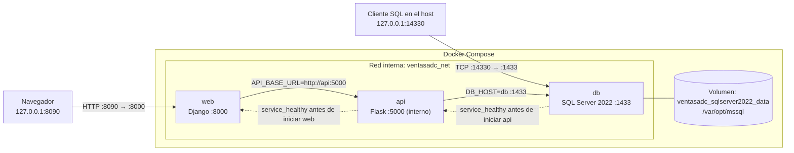

# Sistema de órdenes — Examen del Segundo Parcial

Proyecto académico compuesto por SQL Server 2022, una API REST en Flask y una interfaz web en Django, orquestados con Docker Compose.

## Integrante

| Nombre completo | Número de cuenta |
|---|---:|
| Melvin Edgardo Peña Caballero | 201230010100 |

## Arquitectura



### Servicios, puertos y límites

| Servicio | Función y acceso | CPU | Memoria | Límite de PIDs |
|---|---|---:|---:|---:|
| `db` | SQL Server; host `127.0.0.1:14330` → contenedor `1433` | 2 | 2 GB | No configurado |
| `api` | Flask; puerto `5000` disponible solo dentro de la red Docker | 1 | 512 MB | No configurado |
| `web` | Django; host `127.0.0.1:8090` → contenedor `8000` | 1 | 512 MB | 256 |

Los tres servicios están en la red `ventasadc_net`. SQL Server conserva sus datos en el volumen nombrado `ventasadc_sqlserver2022_data`, montado en `/var/opt/mssql`. La API espera a que DB esté `healthy`; Web espera a que API esté `healthy`. Los tres servicios tienen healthcheck.

## Requisitos previos

- Docker Desktop con Docker Compose.
- Git para clonar el repositorio.
- Para ejecutar la imagen de SQL Server en la plataforma indicada por Compose se requiere `linux/amd64`. En Mac con Apple Silicon se usa emulación; para un entorno oficialmente compatible, utilice un host Docker `x86_64`.

## Preparar y ejecutar desde cero

1. Clonar el repositorio y entrar en su directorio:

   ```bash
   git clone https://github.com/meledpeca93/Examen2P_ADC_MP_201230010100.git
   cd Examen2P_ADC_MP_201230010100
   ```

2. Copiar la plantilla y editar el archivo local `.env`:

   ```bash
   cp .env.example .env
   ```

   Cambie los valores de ejemplo por contraseñas fuertes propias y una clave secreta de Django. Puede generar esta última con `openssl rand -base64 48`. No publique ni comparta `.env`; el repositorio lo excluye de Git.

3. Validar la configuración y construir e iniciar los servicios:

   ```bash
   docker compose config --quiet
   docker compose up -d --build
   ```

4. Esperar los healthchecks y comprobar el estado:

   ```bash
   docker compose ps
   ```

   DB, API y Web deben aparecer como `healthy`. Si algún servicio no llega a ese estado, consultar sus registros:

   ```bash
   docker compose logs --tail=100 db api web
   ```

5. Abrir la aplicación en el navegador:

   - Web: <http://127.0.0.1:8090>
   - SQL Server desde una herramienta del host, como DBeaver: servidor `127.0.0.1`, puerto `14330`.

## Inicialización de la base de datos

Al iniciar, API espera a que SQL Server esté saludable y ejecuta `db/init.sql`. La inicialización crea `OrdenesDB`, las tablas `ordenes` y `orden_detalle`, y los datos de prueba. El script separa sus lotes con `GO`; API los ejecuta individualmente, configura el login de aplicación y verifica la conexión antes de servir solicitudes. Los datos iniciales incluyen cinco órdenes y al menos dos detalles por orden.

El usuario `ventasadc_app` se utiliza para las operaciones normales de la API; `sa` se usa durante la inicialización. No borre el volumen si desea conservar los datos.

## Pruebas de la API

API no publica el puerto `5000` al host. Para probarla con `curl`, ejecutar las solicitudes desde el contenedor `api`:

```bash
docker compose exec -T api curl -i http://127.0.0.1:5000/health
docker compose exec -T api curl -i http://127.0.0.1:5000/api/ordenes
docker compose exec -T api curl -i http://127.0.0.1:5000/api/ordenes/1
```

Las rutas CRUD, validaciones y resultados de pruebas están descritos en [Arquitectura.md](./Arquitectura.md#2-api-rest).

## Persistencia y apagado

Para comprobar la persistencia, registre un dato existente en DBeaver, apague y vuelva a iniciar los servicios y confirme que el dato continúa:

```bash
docker compose down
docker compose up -d
docker compose ps
```

`docker compose down` conserva el volumen. **No use `docker compose down -v` para esta prueba**, porque elimina el volumen y sus datos. Para eliminar voluntariamente todos los datos persistidos, use `docker compose down -v`.

## Evidencias

Las capturas web disponibles están en [`evidencias/`](./evidencias/):

- [Pantalla principal](<./evidencias/1.Pantalla Principal.png>)
- [Crear orden](<./evidencias/2.Crear Orden.png>)
- [Ver orden y detalles](<./evidencias/3. Ver Orden_Detalles.png>)
- [Agregar detalle](<./evidencias/4.Agregar Detalle_Orden.png>)
- [Editar orden](<./evidencias/5.Editar Orden.png>)
- [Consumo de recursos con `docker stats`](<./evidencias/7.Docker compose Stats.png>)

La captura de `docker stats` muestra CPU, memoria usada frente al límite, tráfico y PIDs actuales. Para capturar los valores de configuración de CPU, memoria y PIDs, use también `docker inspect`; la configuración de límites por servicio está en la tabla anterior.

```bash
docker stats --no-stream $(docker compose ps -q)
docker inspect --format='{{.Name}} CPUQuotaNano={{.HostConfig.NanoCpus}} MemoryBytes={{.HostConfig.Memory}} PidsLimit={{.HostConfig.PidsLimit}}' $(docker compose ps -q)
```

**Capturas aún por agregar a `evidencias/`:**

- `docker compose ps` mostrando los tres servicios `healthy`.
- Una prueba de API en terminal con `curl` y su respuesta.
- La comprobación de los datos antes y después de `docker compose down` y `docker compose up`.

Las pruebas de API y persistencia ya están documentadas en [Arquitectura.md](./Arquitectura.md); falta guardar sus capturas correspondientes.

## Imágenes publicadas

- API: [`penia93/examen2p-api:v1.0`](https://hub.docker.com/r/penia93/examen2p-api)
- Web: [`penia93/examen2p-web:v1.0`](https://hub.docker.com/r/penia93/examen2p-web)

Compose construye las imágenes desde el código del repositorio con `docker compose up -d --build`. Para consultar los detalles de la arquitectura y las validaciones realizadas, ver [Arquitectura.md](./Arquitectura.md).
